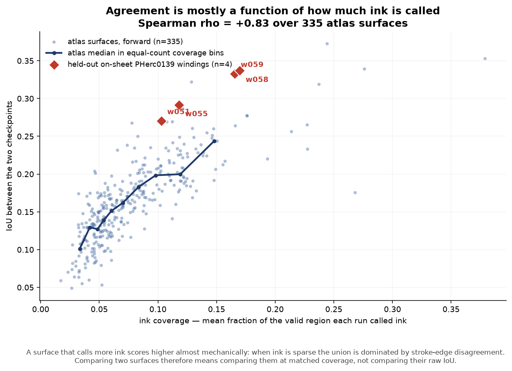
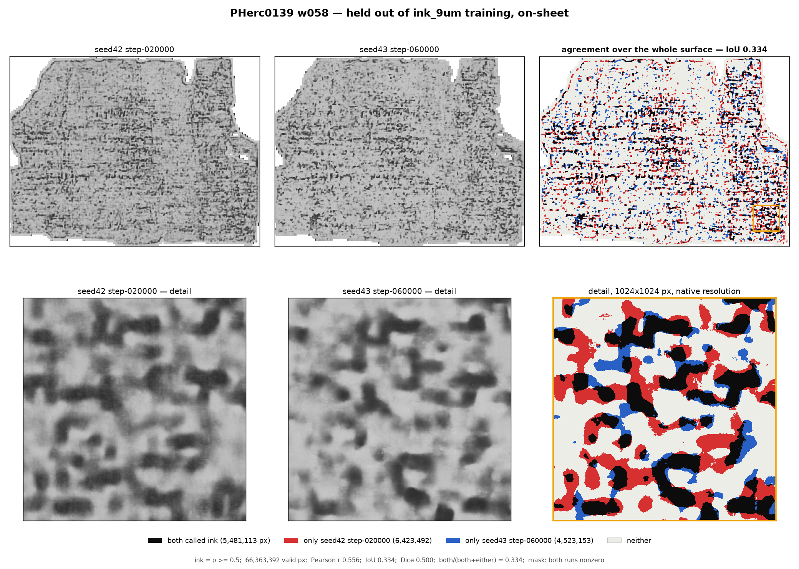

# inkrepro

How much of an ink prediction survives changing the checkpoint?

An ink model turns a flattened surface into a probability map, and that map gets looked at, screened,
and sometimes published. What is almost never reported next to it is how much of it would still be
there if the same model had been trained with a different random seed, or stopped at a different
step. This tool measures that.

It needs no GPU and runs no inference. The eligible-scroll atlas already publishes, for all 340
surfaces across the eight eligible scrolls, the output of three ink checkpoints run at identical
settings. Comparing them is a download, a correlation, and a delete.

## What it reports

For a pair of predictions over the valid region of one surface:

- **`iou`** — of every pixel that at least one run called ink, the fraction both called ink. This is
  the number to read.
- `dice`, `pearson_r` — reported because they are what gets quoted. `pearson_r` is computed over a
  region that is mostly not ink, so it reads higher than the ink itself agrees.
- `frac_ink_a`, `frac_ink_b`, `mean_abs_diff`, `n_valid`.

Every pair is labelled by what actually differs between the two runs:

| `comparison` | meaning |
|---|---|
| `checkpoint` | different checkpoint, same reading direction. The one that answers the question. |
| `direction` | *same* checkpoint, layer order reversed. This reads the other face of the sheet, so the two are not meant to agree, and these rows must not be averaged in with the others. |
| `checkpoint+direction` | both differ. Reported for completeness, interpret with care. |

## Usage

```bash
pip install -e .

# two prediction TIFFs you already have
inkrepro pair a.tif b.tif --mask valid_mask.tif

# every published prediction for one surface, downloaded and compared
inkrepro surface PHerc0813 z4704_w080

# the whole atlas, one surface at a time, downloading and deleting as it goes
inkrepro population manifest.csv --out results/population.csv --resume
```

```bash
# render what the two checkpoints disagree about
inkrepro figure a.tif b.tif --mask valid_mask.tif --out fig.png \
  --label-a "seed42 step-020000" --label-b "seed43 step-060000"
```

`--resume` skips surfaces already present in the output, so an interrupted run continues rather than
starting over. One surface that fails to download does not stop the run; it is counted and reported
at the end.

## The figures


Black is ink both checkpoints called, red and blue are ink only one of them called, pale grey is
valid surface neither called ink. The detail window is chosen as the area with the *most ink*, not
the most disagreement — picking the window where the two runs differ most would be choosing the
evidence to fit the claim.

The ink/no-ink decision is always made at full resolution and only then downsampled for display.
Downsampling the probabilities first and thresholding afterwards answers a different question: a
blurred 0.4 and 0.6 average to 0.5 and appear as ink that neither run actually called.

## The masking rule

Agreement has to be measured over a stated region, and the region matters more than it looks.
`inkrepro` always measures over a valid-pixel mask.

Pass `--mask valid_mask.tif` when you have it. That mask is authoritative and is used on its own,
*not* intersected with "both runs wrote something" -- a pixel inside the valid region that a model
scored exactly 0.0 is a real prediction of "no ink", and dropping it would bias the comparison
toward the pixels both models already felt strongly about.

Without a mask the fallback is "both runs wrote a nonzero value", which is all a bare pair of TIFFs
makes available. It is a convenience, not an equivalent, and the CLI says so when it uses it.

**How much the rule matters, measured.** On PHerc0813 z4704_w080 the published `valid_mask.tif`
covers 7,906,886 px; the union of the six maps' nonzero pixels covers 12,097,632 px, 1.53x as many.
The mask is a strict subset of that union and there is *no* pixel inside the mask where every run
wrote 0. So the models write nonzero well outside the traced sheet, and the fallback's error is that
it adds off-sheet pixels rather than that it discards genuine zeros. (An earlier version of this
file claimed the opposite; see `CORRECTIONS.md`.)

Across 7 atlas surfaces spanning the coverage range, swapping the published mask for the fallback
moves IoU by up to **0.151**. Two agreement numbers computed under different masking rules are
therefore not comparable, and any quoted IoU should name the mask it used.

## The evaluator is validated before it is used

A metric that has not been checked against known inputs cannot tell a real disagreement from its own
arithmetic. `tests/test_metrics.py` covers:

- **A/A** — a prediction against itself scores exactly 1.0, before and after uint8 round-tripping.
- **Planted perturbations** — agreement falls monotonically as noise of increasing known size is
  added, and a hand-counted label flip lands on the hand-computed IoU.
- **The masking rule** — two runs that anticorrelate on every real pixel must not score as agreeing
  because they both wrote zero across the empty 80% of the canvas.
- **Degenerate cases** — disjoint ink scores 0, no ink anywhere scores 1 rather than dividing by
  zero, mismatched shapes raise instead of silently cropping.
- **A float32 precision trap** — `np.full((8, 8), 0.1, np.float32).std()` is `7.45e-09`, not zero.
  An `== 0` guard against constant input therefore never fires, and the constant region reaches
  `corrcoef` and comes back as a divide-by-almost-zero rather than a clean NaN. The statistics are
  computed in float64 against a tolerance far below one uint8 step. This was a real bug in this
  code, caught by its own tests.

Run them with `pytest`. `RuntimeWarning` is an error in this project, so a silently degenerate
computation fails the suite rather than printing a warning nobody reads.

## What it found on the eligible-scroll atlas

Run over all 340 surfaces in `rodriguescarson/eligible-scroll-atlas-renders`, comparing the two
independently seeded 9.362 um checkpoints (`hybrid_3d2d-seed42/step-020000` and
`hybrid_3d2d-seed43/step-060000`) at the settings the atlas itself used:


| | median IoU |
|---|---|
| independent seeds, 335 atlas surfaces, 670 comparisons | **0.160** (IQR 0.127-0.195) |
| positive control: seed42 vs a soup derived from seed42 | 0.351 (2.20x) |

Two checkpoints that differ only in training seed agree on about a sixth of the ink they call. The
median holds across all eight scrolls, from 0.132 (PHerc0268) to 0.191 (PHerc0813), and across
reading direction (forward 0.161, reverse 0.158).

The positive control is the check that the measure means anything: `soup42_early3` is derived from
the seed42 run, so it is not an independent opinion, and it scores 2.2x higher. A metric that could
not tell those apart would not be worth reporting.

**Five of the 340 surfaces are missing, and they are exactly the five that passed the ink screen**
(`maps_held=True` in the manifest: PHerc0358 z11280_w020, PHerc0813 z5888_w020, z7696_w020,
z12496_w060, z13088_w040). Their maps are held back, so they returned 404. Since those are the
surfaces most likely to carry real ink, and real ink plausibly reproduces better, excluding them
may bias the population figure downward. The number is 335 surfaces, not 340, and not a claim about
the candidates.

Reproduce with:

```bash
inkrepro population manifest.csv --out results/population.csv --resume
python scripts/plot_population.py results/population.csv figures/population.png \
  results/held_out_control.csv
```

## This number is not a per-surface confidence score

IoU rises steeply with how much ink a surface calls. Over the 335 atlas surfaces the rank
correlation between coverage and agreement is **Spearman +0.83** (Pearson +0.79):



| coverage quartile | median ink coverage | median IoU |
|---|---|---|
| least ink | 0.040 | 0.112 |
| | 0.055 | 0.142 |
| | 0.080 | 0.173 |
| most ink | 0.122 | 0.216 |

Most of that is mechanical rather than interesting. When ink is sparse the union of the two runs is
dominated by disagreement along stroke edges, so IoU falls whether or not the models are saying
anything different about the papyrus.

The consequence is the main caveat on this whole tool: **a surface scoring above the atlas median is
not evidence of anything until it is compared with surfaces that call a similar amount of ink.** The
first version of this README drew exactly that unsupported conclusion; see `CORRECTIONS.md`.

## A held-out on-sheet control

The question worth asking is whether surfaces that really sit on the papyrus reproduce better than
the atlas surfaces do, once coverage is matched. That needs an on-sheet surface the models were not
trained on.

The trained-on PHerc0139 public segments are w029, w030, w035, w039, w040, w041, w043, w044 and
w045 (from the [ink_9um label tables](https://huggingface.co/buckets/scrollprize/datasets/tree/ink_9um)).
Four windings of the same scroll, on the same 9.362 um scan, appear in neither training list:

| winding | ink coverage | IoU, forward | ink-matched atlas median | delta | percentile |
|---|---|---|---|---|---|
| w051 | 0.103 | 0.270 | 0.197 (n=87) | **+0.074** | 98.9% |
| w055 | 0.118 | 0.292 | 0.208 (n=70) | **+0.084** | 98.6% |
| w058 | 0.170 | 0.337 | 0.239 (n=17) | **+0.098** | 100% |
| w059 | 0.166 | 0.333 | 0.228 (n=19) | **+0.105** | 100% |

"Ink-matched" means atlas surfaces whose coverage is within +/-25% of that winding's. Read the other
face of the sheet and the effect shrinks to +0.021 to +0.060 (reverse direction, 73rd-92nd
percentile), which is what you would expect if it is being carried by ink that is really there.



**What this is worth, stated carefully.** All four held-out windings beat their ink-matched atlas
band, in the same direction, at the 98.6th percentile or above. But these four surfaces ship no
`valid_mask.tif`, so their masks are reconstructed as `erode(union of nonzero footprints, 64)` --
the same construction the atlas used, applied to what is available. Measured against the published
mask on 10 atlas surfaces in the same coverage band, that reconstruction errs by mean -0.010 and at
most **0.047**. That is about half the smallest effect, so the *sign* is robust to the worst error
observed, while the *magnitude* is good to roughly +/-0.05.

So: suggestive, not established. What would settle it is the published `valid_mask.tif` for these
four windings, or their surface volumes, so the mask can be computed exactly rather than
reconstructed. Until then this is one more surface-level screen worth checking, not a result to
build on.

## Limitations

- Agreement between checkpoints is not accuracy. Two models can agree on something that is not ink,
  and the published 9.362 um checkpoints share training data, so these numbers are an upper bound on
  how independent they really are.
- IoU is strongly confounded by ink coverage (Spearman +0.83). Never compare two surfaces' raw
  agreement without matching on coverage first.
- Agreement numbers are only comparable when computed under the same masking rule; the rule can move
  IoU by up to 0.151 (see "The masking rule").
- `soup42_early3` is derived from the seed42 run, so a `s42_020k` vs `soup42_early3` row is not two
  independent opinions.
- The available checkpoint pairs differ in training step as well as seed, so a single
  cross-checkpoint number mixes the two. Separating them needs matched-step pairs, which exist for
  `step-010000` on both seeds.
- `direction` rows answer a different question and are labelled, not excluded. Filter on the
  `comparison` column before computing any summary.
- The held-out on-sheet result rests on four surfaces with reconstructed masks. See the caveat in
  that section, and `CORRECTIONS.md` for the control it replaced.

## Licence

MIT.
