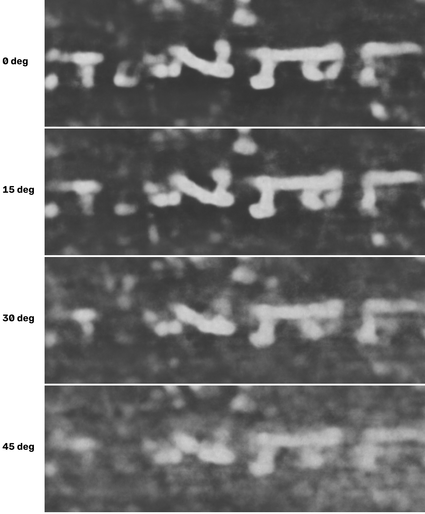
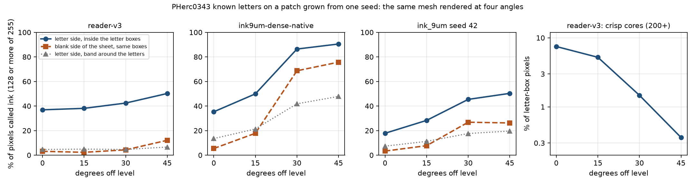

# Level a grown patch before an ink model reads it

A patch grown from a seed comes out at a random angle. On a tilted patch, three ink models call ink where there is
none, and the one that draws crisp letters stops drawing them. Turning the mesh so the text rows are level fixes
both. This folder has the measurement and a one-command tool.

Measured on 22 November 2026, on the PHerc0343 letters that won First Letters, and repeated on the PHerc0211 letters.

## The test

Erwin Nieuwlaar published 18 letter boxes with his winning PHerc0343 reading
([his repo](https://github.com/Nieuwlaar/pherc343-first-letters), commit `e8370f1`). They are a known answer.

I did not use his surface. I grew my own patch from one seed placed on letter 5 with `vc_grow_seg_from_seed`
(step 20, 140 generations, 30 cm²). It is in [`data/k343_L5.tifxyz`](data/k343_L5.tifxyz). His boxes are carried
onto it in 3D: every point of his mesh inside a box is matched to the nearest point of my patch. Letters 1 to 13
match at 75 to 100 per cent, so the patch is on the written sheet there.

The patch came out with its text rows 43 degrees off level.

I then turned the mesh so the rows sat level, and 15, 30 and 45 degrees off level, and rendered each one with
`vc_render_tifxyz`. Same voxels, same depth. No image was rotated after rendering. Three models read each render:
[reader-v3](https://huggingface.co/domenicor046/reader-v3),
[ink9um-dense-native](https://huggingface.co/Nieuwlaar/ink9um-dense-native) and
[ink_9um](https://huggingface.co/scrollprize/ink_9um) seed 42.

## What happens

Share of pixels each model calls ink (128 or more out of 255). First inside the 18 letter boxes on the written
side. Then inside the same boxes on the **blank** side of the sheet, where there is nothing to find.

| Degrees off level | 0 | 15 | 30 | 45 |
|---|---|---|---|---|
| reader-v3, written side | 37% | 38% | 42% | 50% |
| reader-v3, blank side | 3% | 2% | 4% | 12% |
| dense-native, written side | 35% | 50% | 86% | 90% |
| dense-native, blank side | 5% | 18% | 69% | 76% |
| ink_9um seed 42, written side | 18% | 28% | 45% | 50% |
| ink_9um seed 42, blank side | 3% | 8% | 27% | 26% |

Level, all three models tell the two sides apart: 3 to 5 per cent on the blank side. At 30 degrees dense-native
calls ink on 69 per cent of the blank side and ink_9um on 27 per cent. The background around the letters rises the
same way (dense-native: 14 per cent level, 48 per cent at 45 degrees).

So on a tilted patch "the model sees ink here" stops meaning much, and "is it on one side only" stops working as a
check, because the wrong side lights up too.

reader-v3 is the model that draws crisp strokes. Those go as well. Pixels at 200 or more inside the letter boxes:

| Degrees off level | 0 | 15 | 30 | 45 | as grown (43) |
|---|---|---|---|---|---|
| reader-v3 crisp pixels | 7.5% | 5.2% | 1.5% | 0.36% | 0.27% |

That is 21 times fewer at 45 degrees.



The same seven letters, reader-v3, written side. One grey scale, no per-strip stretch.



Every number, both sides, all thresholds: [`results/angle_sweep.csv`](results/angle_sweep.csv).

A quarter turn or a half turn from level costs little (5.9 and 6.9 per cent crisp pixels with reader-v3; these two
were measured by turning the rendered layers, not the mesh). The models want the rows along an image axis. They do
not care which.

### One trap

Off level, the usual summary numbers get **better**. More pixels above 0.5 inside the boxes, and a higher AUC
against the boxes (reader-v3: 0.66 level, 0.84 at 45 degrees). If you rank patches by how much ink a model calls, a
tilted patch beats a level one. It is grey haze filling the boxes, not letters.

## The same test on a second scroll

PHerc0211 is another First Letters scroll with a published surface: Priyank Aranke's three-row surface and his
probability map on it, from the public folder he released with his submission (CC BY-NC 4.0). It is a different
scroll, a different scan resolution (9.362 um), different letters, and the reference is a different
model's output, not letter boxes.

First, do the three models see his letters at all? On his surface as published, rendered by me, reader-v3 marks
42 per cent of what his model calls ink (probability 0.5 or more) and 0.2 per cent of what it calls blank (0.1 or
less). The two maps correlate at 0.72. So the readers work on this scroll.

Then I turned his surface 15, 30 and 45 degrees off level with `level_tifxyz.py`, rendered each, and read each with
the three models. His probability map is carried onto each turned render through 3D, so the score does not depend
on the angle.

| Degrees off level | 0 | 15 | 30 | 45 |
|---|---|---|---|---|
| reader-v3, correlation with his map | 0.70 | 0.71 | 0.65 | 0.58 |
| dense-native, correlation with his map | 0.59 | 0.57 | 0.35 | 0.27 |
| ink_9um seed 42, correlation with his map | 0.39 | 0.36 | 0.25 | 0.22 |
| reader-v3, crisp pixels (200+) on his ink | 5.3% | 3.3% | 1.6% | 0.94% |
| reader-v3, blank side, on his ink | 6% | 6% | 9% | 16% |
| dense-native, blank side, on his ink | 11% | 27% | 76% | 86% |
| ink_9um seed 42, blank side, on his ink | 4% | 11% | 29% | 37% |
| dense-native, written side, on his blank | 1% | 3% | 13% | 26% |

The same three things happen as on PHerc0343. The blank side lights up. The models call ink where the reference
says there is none. reader-v3 loses its crisp strokes, here by a factor of 6 at 45 degrees.

Every number: [`results/angle_sweep_pherc0211.csv`](results/angle_sweep_pherc0211.csv). Scorer:
[`reference_map_eval.py`](reference_map_eval.py). His files are not copied here.

## How tilted is a grown patch?

I grew 61 more patches the same way on PHerc 0125, 0211, 0257, 0800, 0813 and 0826. Their text direction was a
median 25 degrees off the nearest grid axis. 57 per cent were more than 20 degrees off, 43 per cent more than 30.
The list is in [`results/patch_angles.csv`](results/patch_angles.csv).

## The tool

```bash
pip install numpy tifffile opencv-python-headless
python level_tifxyz.py grown_patch.tifxyz level_patch.tifxyz --umbilicus umbilicus.json
```

It fits a plane to z over the patch grid, resamples x, y and z on a grid turned by that angle, and writes a new
tifxyz. Holes stay holes. Nothing downstream changes: `vc_render_tifxyz` takes the output as it is, and the level
numbers above come from exactly that path.

With `--umbilicus` (or `--center X Y`) it also makes the grid normal point out of the scroll, by reversing the
columns when it points in. Rows along +z with the normal pointing out is the standard segment orientation that
villa's `vc_render_tifxyz.cpp` describes next to `--flip-normals`. So a grown patch can be read in one direction
instead of two, and the image is not mirrored. `vc_render_tifxyz --rotate` only takes quarter turns, which is why
this is its own step.

Other options: `--angle DEG` to set the angle yourself, `--flip-z` for a scroll scanned upside down.
Tests: [`../tests/test_level_tifxyz.py`](../tests/test_level_tifxyz.py).

## Doing it again

1. Grow: `vc_grow_seg_from_seed -v <m7 surface prediction of PHerc0343, https URL> -t out -p params.json --seed 5920 4489 10453`
   with `{"mode": "seed", "step_size": 20, "generations": 140, "min_area_cm": 0.5, "voxelsize": 8.64}` (VC3D build
   `f7756c7`). Or start from `data/k343_L5.tifxyz`.
2. Turn: `python level_tifxyz.py data/k343_L5.tifxyz level` for level; add `--angle -122.354`, `-107.354` or
   `-92.354` for 15, 30 and 45 degrees off (the fitted angle is -137.354).
3. Render: `vc_render_tifxyz --volume <PHerc0343 8.64 um masked volume> --group-idx 0 --scale 1 --segmentation <mesh> --num-slices 41 --slice-step 1 --pyramid 0 --zarr-output <out>.zarr`.
   No `--flip-normals`, so on this patch the written side is the reverse layer order.
4. Read: villa's `vesuvius.ink_detection.inference.infer` at commit `0fb38c4`, `--direction both --overlap 0.5 --blend-mode hann --layer-start 12 --layer-end 29`.
5. Score: `python known_row_eval.py <mesh> <winner's concat_w047-w048 tifxyz> <his letter_boxes.json> <maps...>`.
   It matches the boxes in 3D, so it does not care how the mesh is turned.

## What this does not show

- Two known texts on two scrolls, both with ink strong enough to have been read already. Fainter ink may behave
  differently. I have not measured it.
- On PHerc0211 the reference is another model's probability map. That model was trained partly on reader-v2 labels,
  so its agreement with reader-v3 is not fully independent.
- The PHerc0343 letters are still recognisable at 45 degrees with reader-v3. What goes first is the fine detail.
- Three models, at one depth. I have not tested Hecate or the TimeSformer models.
- Why the models do this. My guess is that they were trained on level text and level fibres. I have not tested it.
- An earlier version of this test rotated the rendered layers instead of the mesh. That mixes text angle with
  resampling blur, so those numbers are not quoted here. They agree in direction and roughly in size.

I read my own 61 patches level. 57 of them are on five scrolls nobody has read yet (PHerc 0125, 0257, 0800, 0813,
0826). An automatic count of marks per row found nothing like the known row there: the best patch had 8 marks in a
row, the known letters give 13. That is a screen, not an eye check.

## Credit and licence

The PHerc0343 letter boxes and reference mesh are Erwin Nieuwlaar's (MIT). The PHerc0211 surface and probability
map are Priyank Aranke's (CC BY-NC 4.0); only numbers derived from them are here. The models are by domenicor046,
Erwin Nieuwlaar and the Vesuvius Challenge team. The tracer and renderer are villa's VC3D.

Code here: MIT, like the rest of this repository. The mesh, the figures and the tables are derived from the
Vesuvius Challenge scan of PHerc0343 and follow the licence of that data (CC BY-NC 4.0 at the time of writing; see
scrollprize.org/data).
